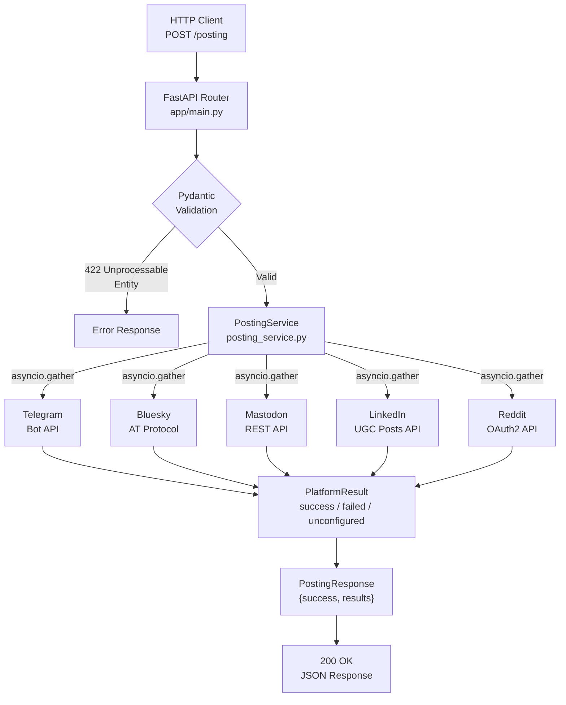
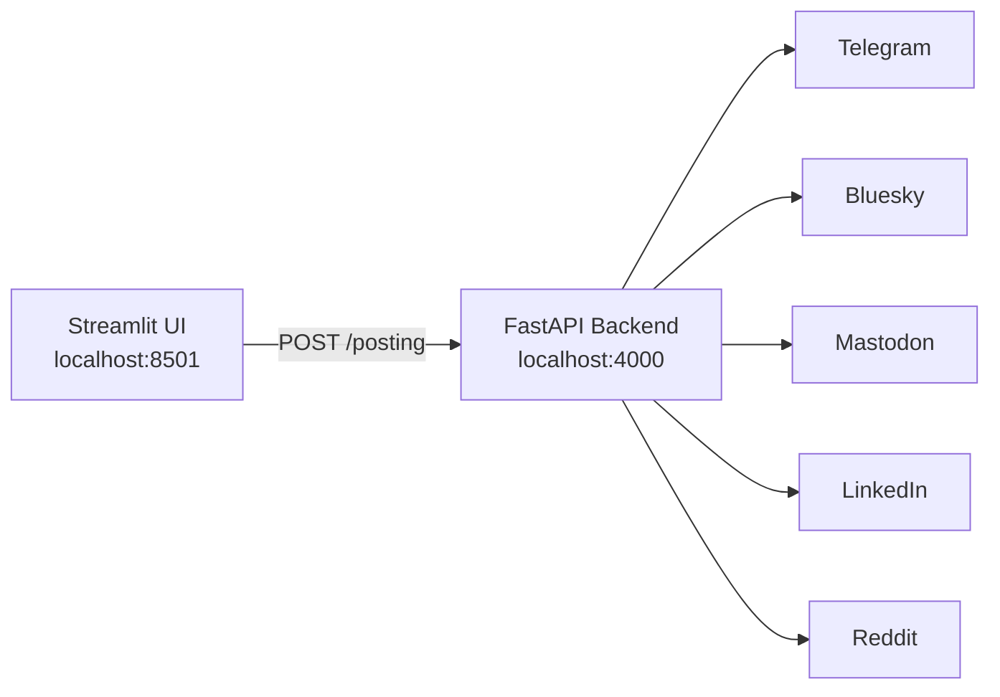

# Automated Multi-Platform Posting System

<div align="center">

[](https://www.python.org/downloads/)
[](https://fastapi.tiangolo.com/)
[](https://streamlit.io/)
[](LICENSE)
[](tests/)
[](https://docs.pydantic.dev/)
[](https://docs.python.org/3/library/asyncio.html)

> **Technical Assignment – Dxora Technologies**  
> Built with FastAPI · Python 3.11+ · asyncio · HTTPX · Streamlit

</div>

---

## Table of Contents

1. [Project Overview](#project-overview)
2. [Assignment Objective](#assignment-objective)
3. [Features](#features)
4. [Technology Stack](#technology-stack)
5. [Architecture](#architecture)
6. [Project Structure](#project-structure)
7. [Quick Start](#quick-start)
8. [Installation](#installation)
9. [Environment Configuration](#environment-configuration)
10. [Streamlit Frontend](#streamlit-frontend)
11. [API Endpoint Documentation](#api-endpoint-documentation)
12. [Sample Request & Response](#sample-request--response)
13. [API Response Codes](#api-response-codes)
14. [Platform API Documentation Links](#platform-api-documentation-links)
15. [Error Handling Strategy](#error-handling-strategy)
16. [Testing](#testing)
17. [Troubleshooting](#troubleshooting)
18. [Known Limitations](#known-limitations)
19. [Security Considerations](#security-considerations)
20. [Contributing & Assignment Notes](#contributing--assignment-notes)
21. [License](#license)
22. [GitHub Submission Checklist](#github-submission-checklist)

---

## Project Overview

The **Automated Multi-Platform Posting System** is a production-quality FastAPI backend that accepts a single REST API call containing a marketing message and concurrently publishes it to **five social media platforms**:

| Platform | Protocol | Auth Method |
|----------|----------|-------------|
| Telegram | Bot API | Bot Token |
| Bluesky | AT Protocol (XRPC) | App Password → JWT Session |
| Mastodon | REST API v1 | OAuth2 Bearer Token |
| LinkedIn | UGC Posts API v2 | OAuth2 Bearer Token |
| Reddit | OAuth2 REST API | Password Flow → Bearer Token |

Each platform integration is **fully independent**. A failure on one platform does not cancel or affect the others. A **Streamlit web UI** is included for one-click posting without curl or Swagger.

---

## Assignment Objective

Demonstrate production-level Python backend skills including:

- FastAPI REST API design with Pydantic validation
- Real third-party API integrations (no mocks in production code)
- Concurrent async programming with `asyncio.gather`
- Robust error handling and input validation
- Clean, testable, maintainable architecture
- Professional documentation

---

## Features

- ✅ `POST /posting` REST endpoint
- ✅ Concurrent publishing to 5 platforms via `asyncio.gather`
- ✅ Strict message validation (length, URL count, URL scheme, URL syntax)
- ✅ Per-platform independent error handling
- ✅ Graceful handling of missing credentials (`unconfigured` status)
- ✅ Real post URLs retrieved from each platform's API response
- ✅ Sanitized error messages (no credentials exposed)
- ✅ Swagger UI at `/docs`, ReDoc at `/redoc`
- ✅ Health check endpoint at `/health`
- ✅ Comprehensive automated test suite (no real credentials needed)
- ✅ All credentials loaded from environment variables
- ✅ Streamlit web UI for browser-based posting
- ✅ One-click launcher (`start.bat`) for Windows

## Technology Stack

| Component | Technology |
|-----------|-----------|
| Web framework | FastAPI 0.115 |
| ASGI server | Uvicorn |
| Data validation | Pydantic v2 |
| Configuration | pydantic-settings |
| HTTP client | HTTPX (async) |
| Async runtime | asyncio (stdlib) |
| Testing | Pytest + pytest-asyncio |
| Test HTTP | FastAPI TestClient |
| Frontend UI | Streamlit |
| UI HTTP client | HTTPX (sync) |

---

## Architecture

### ASCII Diagram

```
┌─────────────────────────────────────────────┐
│              HTTP Client                     │
│         POST /posting {message}              │
└──────────────────┬──────────────────────────┘
                   │
         ┌─────────▼──────────┐
         │   FastAPI Router   │
         │   (app/main.py)    │
         └─────────┬──────────┘
                   │ MessageRequest (Pydantic validation)
         ┌─────────▼──────────┐
         │   PostingService   │
         │ (services/posting_ │
         │   service.py)      │
         └─────────┬──────────┘
                   │ asyncio.gather(*tasks)
    ┌──────┬───────┼────────┬──────────┐
    │      │       │        │          │
 Telegram Bluesky Mastodon LinkedIn  Reddit
    │      │       │        │          │
    └──────┴───────┴────────┴──────────┘
                   │ [PlatformResult × 5]
         ┌─────────▼──────────┐
         │  PostingResponse   │
         │  {success, results}│
         └────────────────────┘
```

Each platform extends `BasePlatform` (abstract base class) and returns a standardised `PlatformResult`.

### Mermaid Flowchart





---

## Project Structure

```
automated-posting/
│
├── app/
│   ├── __init__.py          # Package init
│   ├── main.py              # FastAPI app, routes, lifespan
│   ├── schemas.py           # Pydantic request/response models + validation
│   ├── config.py            # pydantic-settings configuration
│   │
│   ├── platforms/
│   │   ├── __init__.py
│   │   ├── base.py          # Abstract BasePlatform with shared helpers
│   │   ├── telegram.py      # Telegram Bot API integration
│   │   ├── bluesky.py       # Bluesky AT Protocol integration
│   │   ├── mastodon.py      # Mastodon REST API integration
│   │   ├── linkedin.py      # LinkedIn UGC Posts API integration
│   │   └── reddit.py        # Reddit OAuth2 API integration
│   │
│   └── services/
│       ├── __init__.py
│       └── posting_service.py  # Concurrent orchestration service
│
├── tests/
│   ├── __init__.py
│   ├── test_validation.py   # Message + URL validation tests
│   ├── test_posting.py      # PostingService unit tests
│   └── test_platforms.py    # Per-platform unit tests (all HTTP mocked)
│
├── docs/
│   └── screenshots/         # ← Place UI / test screenshots here
│
├── streamlit_app.py         # Streamlit web UI frontend
├── start.bat                # One-click Windows launcher (backend + UI)
├── .env                     # ← Local credentials (NEVER commit)
├── .env.example             # Template for required environment variables
├── .gitignore               # Excludes .env, __pycache__, etc.
├── pytest.ini               # Pytest configuration
├── requirements.txt         # Pinned dependencies
└── README.md                # This file
```

---

## Quick Start

> **Get the system running in 3 commands** (requires Python 3.11+, credentials already in `.env`):

```bash
# 1. Clone & enter the project
git clone https://github.com/Vijayan1606/automated-multiposting-platform.git && cd automated-multiposting-platform

# 2. Install dependencies
pip install -r requirements.txt

# 3a. Start the API backend
uvicorn app.main:app --host 0.0.0.0 --port 4000
```

Then open:
- **API:** http://localhost:4000/docs
- **Streamlit UI:** `streamlit run streamlit_app.py` → http://localhost:8501

**Windows one-click launcher:**

```bat
start.bat
```

> This launches both the FastAPI backend and the Streamlit UI in one go.

---

## Installation

### Prerequisites

- Python 3.11 or 3.12
- pip

### Steps

```bash
# 1. Clone the repository
git clone https://github.com/Vijayan1606/automated-multiposting-platform.git
cd automated-multiposting-platform

# 2. Create and activate a virtual environment
python -m venv .venv

# Windows
.venv\Scripts\activate

# macOS / Linux
source .venv/bin/activate

# 3. Install dependencies
pip install -r requirements.txt

# 4. Configure credentials
cp .env.example .env
# Edit .env and add your API credentials

# 5. Start the backend server
uvicorn app.main:app --host 0.0.0.0 --port 4000

# 6. (Optional) Start the Streamlit frontend in a second terminal
streamlit run streamlit_app.py
```

The API will be available at: `http://localhost:4000`  
The Streamlit UI will be available at: `http://localhost:8501`

---

## Environment Configuration

Copy `.env.example` to `.env` and fill in your credentials.

| Variable | Platform | Required | Default | Description |
|----------|----------|----------|---------|-------------|
| `TELEGRAM_BOT_TOKEN` | Telegram | Yes | _(none)_ | Token from @BotFather |
| `TELEGRAM_CHAT_ID` | Telegram | Yes | _(none)_ | Numeric channel/group ID |
| `BLUESKY_IDENTIFIER` | Bluesky | Yes | _(none)_ | Handle (e.g. `name.bsky.social`) |
| `BLUESKY_APP_PASSWORD` | Bluesky | Yes | _(none)_ | App password from bsky.app settings |
| `MASTODON_INSTANCE_URL` | Mastodon | Yes | _(none)_ | Instance base URL (e.g. `https://mastodon.social`) |
| `MASTODON_ACCESS_TOKEN` | Mastodon | Yes | _(none)_ | Token from instance developer settings |
| `LINKEDIN_ACCESS_TOKEN` | LinkedIn | Yes | _(none)_ | OAuth2 token with `w_member_social` scope |
| `LINKEDIN_PERSON_URN` | LinkedIn | Yes | _(none)_ | `urn:li:person:XXXXXXXX` |
| `REDDIT_CLIENT_ID` | Reddit | Yes | _(none)_ | Script app client ID |
| `REDDIT_CLIENT_SECRET` | Reddit | Yes | _(none)_ | Script app client secret |
| `REDDIT_USERNAME` | Reddit | Yes | _(none)_ | Your Reddit username |
| `REDDIT_PASSWORD` | Reddit | Yes | _(none)_ | Your Reddit account password |
| `REDDIT_USER_AGENT` | Reddit | Yes | _(none)_ | Unique user-agent string |
| `REDDIT_SUBREDDIT` | Reddit | Yes | _(none)_ | Target subreddit (without `r/`) |

**Missing credentials:** Any platform with missing credentials returns `status: "unconfigured"` and is excluded from the `success` calculation. The other platforms continue normally.

### Obtaining Credentials

**Telegram:**
1. Message @BotFather on Telegram → `/newbot`
2. Add the bot to your channel/group as an admin
3. Get the chat ID using [@userinfobot](https://t.me/userinfobot) or the Telegram API

**Bluesky:**
1. Log in at [bsky.app](https://bsky.app)
2. Go to Settings → App Passwords → Add App Password

**Mastodon:**
1. Log in to your instance
2. Preferences → Development → New Application
3. Grant `write:statuses` scope

**LinkedIn:**
1. Create an app at [LinkedIn Developers](https://www.linkedin.com/developers/apps)
2. Request `Sign In with LinkedIn` and `Share on LinkedIn` products
3. Complete the 3-legged OAuth2 flow to obtain an access token
4. Get your Person URN via `GET https://api.linkedin.com/v2/me`

**Reddit:**
1. Go to [Reddit Apps](https://www.reddit.com/prefs/apps)
2. Create a **script** type app
3. Note the client ID (under the app name) and client secret

---

## Streamlit Frontend

The project ships with a full **Streamlit web UI** so you can compose and post messages without touching the terminal or Swagger.

### Running the UI

```bash
# Make sure the FastAPI backend is already running on port 4000, then:
streamlit run streamlit_app.py
```

The UI opens automatically at **http://localhost:8501**

### Windows One-Click Launcher

```bat
start.bat
```

This batch file starts both the FastAPI backend (port 4000) and the Streamlit frontend (port 8501) in separate windows.

### UI Features

| Feature | Description |
|---------|-------------|
| **Compose Panel** | Text area for your message with live character counter |
| **URL Validator** | Real-time feedback — green ✅ / red ❌ indicator as you type |
| **Word Count** | Running word count display |
| **Message Preview** | Shows how the post will appear before submitting |
| **Platform Status Cards** | Displays all 5 platforms with configured / unconfigured state |
| **One-Click Post** | Submit button sends to all configured platforms concurrently |
| **Publishing Animation** | Per-platform progress: ⏳ Posting… → ✅ Done / ❌ Failed |
| **Results Tabs** | All Platforms · Succeeded · Failed tabbed view |
| **Post History Sidebar** | Timestamped history of all posts in the current session |
| **Offline Graceful State** | Shows a clear warning when the backend is unreachable |
| **Health Check** | Calls `GET /health` on load — displays backend status banner |

### UI Endpoints

| Service | URL |
|---------|-----|
| Streamlit UI | http://localhost:8501 |
| FastAPI backend (used by UI) | http://localhost:4000/posting |
| Health check (used by UI) | http://localhost:4000/health |

> **Note:** The UI does **not** need any additional configuration. It reads from the same `.env` credentials that the backend uses. The Streamlit app itself has no credentials — it simply calls the API.

---

## API Endpoint Documentation

### `POST /posting`

Publishes the message to all configured social platforms concurrently.

**Request:**

```
POST http://localhost:4000/posting
Content-Type: application/json
```

**Body schema:**

| Field | Type | Required | Constraints |
|-------|------|----------|-------------|
| `message` | string | Yes | 1–200 characters, exactly one http/https URL |

**Validation rules:**
1. Message must not be empty
2. Message must not exceed 200 characters
3. Message must contain exactly ONE URL
4. URL must use `http` or `https` scheme
5. URL must be syntactically valid (has scheme + valid host)

**Response schema:**

| Field | Type | Description |
|-------|------|-------------|
| `success` | boolean | True only when all configured platforms succeed |
| `results` | array | Per-platform publishing outcomes |
| `results[].platform` | string | Platform name |
| `results[].status` | string | `"success"`, `"failed"`, or `"unconfigured"` |
| `results[].posted_url` | string\|null | Public URL of the published post |
| `results[].public_access` | boolean | True when post is publicly viewable |
| `results[].date` | string\|null | Publish date (YYYY-MM-DD) |
| `results[].time` | string\|null | Publish time (HH:MM:SS) |
| `results[].error` | string\|null | Error message if failed |

**Other endpoints:**

| Method | Path | Description |
|--------|------|-------------|
| GET | `/health` | Application health check |
| GET | `/docs` | Swagger UI |
| GET | `/redoc` | ReDoc documentation |

---

## Sample Request & Response

### Request

```bash
curl -X POST http://localhost:4000/posting \
  -H "Content-Type: application/json" \
  -d '{
    "message": "Check out our latest business platform and grow your online visibility. https://example.com"
  }'
```

### Successful Response (all platforms configured)

```json
{
  "success": true,
  "results": [
    {
      "platform": "Telegram",
      "status": "success",
      "posted_url": "https://t.me/mychannel/42",
      "public_access": true,
      "date": "2026-11-15",
      "time": "10:30:00",
      "error": null
    },
    {
      "platform": "Bluesky",
      "status": "success",
      "posted_url": "https://bsky.app/profile/did:plc:abcdef/post/abc123",
      "public_access": true,
      "date": "2026-11-15",
      "time": "10:30:00",
      "error": null
    },
    {
      "platform": "Mastodon",
      "status": "success",
      "posted_url": "https://mastodon.social/@user/109375745745649537",
      "public_access": true,
      "date": "2026-11-15",
      "time": "10:30:01",
      "error": null
    },
    {
      "platform": "LinkedIn",
      "status": "success",
      "posted_url": "https://www.linkedin.com/feed/update/urn%3Ali%3AugcPost%3A1234567",
      "public_access": true,
      "date": "2026-11-15",
      "time": "10:30:01",
      "error": null
    },
    {
      "platform": "Reddit",
      "status": "success",
      "posted_url": "https://www.reddit.com/r/test/comments/abc123/check_out_our_platform/",
      "public_access": true,
      "date": "2026-11-15",
      "time": "10:30:02",
      "error": null
    }
  ]
}
```

### Partial Failure Response

```json
{
  "success": false,
  "results": [
    {
      "platform": "Telegram",
      "status": "success",
      "posted_url": "https://t.me/mychannel/42",
      "public_access": true,
      "date": "2026-11-15",
      "time": "10:30:00",
      "error": null
    },
    {
      "platform": "Bluesky",
      "status": "failed",
      "posted_url": null,
      "public_access": false,
      "date": null,
      "time": null,
      "error": "Bluesky authentication failed. Check BLUESKY_IDENTIFIER and BLUESKY_APP_PASSWORD."
    },
    {
      "platform": "LinkedIn",
      "status": "unconfigured",
      "posted_url": null,
      "public_access": false,
      "date": null,
      "time": null,
      "error": "Platform credentials are not configured."
    }
  ]
}
```

### Validation Error Response (422)

```json
{
  "detail": ["message: Message must contain exactly one CTA URL (http:// or https://). No URL was found."],
  "hint": "Message must be 1–200 characters and contain exactly one valid http:// or https:// URL."
}
```

---

## API Response Codes

| HTTP Code | Status | When It Occurs | Example |
|-----------|--------|----------------|---------|
| `200 OK` | Success | Request was valid and processed by all configured platforms. Individual platforms may still report `failed` or `unconfigured` within the results array. | Normal post response |
| `422 Unprocessable Entity` | Validation Error | Message fails Pydantic validation — empty, over 200 chars, missing URL, multiple URLs, non-http/https URL, or malformed URL. | `"message": "hello world"` (no URL) |
| `500 Internal Server Error` | Server Error | Unexpected unhandled exception at the application layer (not at the platform level — platform errors become `failed` results). | Rare; indicates a bug |

> **Note:** Platform-level failures (auth errors, rate limits, timeouts) are **not** 500s — they return `200 OK` with `status: "failed"` in the results array. This is by design to allow partial success reporting.

---

## Platform API Documentation Links

| Platform | Documentation |
|----------|--------------:|
| Telegram Bot API | https://core.telegram.org/bots/api |
| Bluesky AT Protocol | https://docs.bsky.app/docs/tutorials/creating-a-post |
| Mastodon API | https://docs.joinmastodon.org/methods/statuses/ |
| LinkedIn UGC Posts API | https://learn.microsoft.com/en-us/linkedin/marketing/community-management/shares/posts-api |
| Reddit API | https://www.reddit.com/dev/api/ |

---

## Error Handling Strategy

### Per-Platform Independence

Each platform's `publish()` method is wrapped in a `_safe_publish()` guard inside `PostingService`. This means:

- An exception in platform A does **not** cancel platforms B, C, D, E.
- Unexpected bugs (Python exceptions) are caught and converted to `failed` results.
- `asyncio.gather(return_exceptions=True)` is used as an additional safety layer.

### Error Categories

| Error Type | Handling |
|-----------|---------|
| Missing credentials | Returns `unconfigured` result immediately, no HTTP request made |
| Auth failure (401/403) | Returns `failed` with descriptive error (token/scope), credentials never exposed |
| Rate limit (429) | Returns `failed` with retry timing from `Retry-After` header |
| Network timeout | Returns `failed` with "Request timed out." |
| DNS/connection error | Returns `failed` with sanitised network error type |
| API validation error (422) | Returns `failed` with API error message |
| Unexpected server error (5xx) | Returns `failed` with HTTP status code |
| Malformed JSON response | Returns `failed` with description |

### Credential Sanitization

No error message ever contains:
- API tokens or passwords
- Internal server paths
- Raw response headers with auth information

---

## Testing

### Run all tests

```bash
pytest -v
```

### Run specific test modules

```bash
pytest tests/test_validation.py -v    # Validation tests
pytest tests/test_posting.py -v       # Service tests
pytest tests/test_platforms.py -v     # Platform unit tests
```

### Test coverage

```bash
pip install pytest-cov
pytest --cov=app --cov-report=term-missing
```

### Integration testing (requires real credentials)

With credentials populated in `.env`, start the server and use:

```bash
# Start the server
uvicorn app.main:app --host 0.0.0.0 --port 4000

# Test with curl
curl -X POST http://localhost:4000/posting \
  -H "Content-Type: application/json" \
  -d '{"message": "Test post https://example.com"}'
```

Or use the Swagger UI at `http://localhost:4000/docs`.

### Test scenarios covered

| Test | File |
|------|------|
| Valid message with one URL | test_validation.py |
| Empty message rejected | test_validation.py |
| Message >200 chars rejected | test_validation.py |
| Message without URL rejected | test_validation.py |
| Two URLs rejected | test_validation.py |
| Invalid URL rejected | test_validation.py |
| FTP URL rejected | test_validation.py |
| Malformed URL rejected | test_validation.py |
| Whitespace-only rejected | test_validation.py |
| URL with query params accepted | test_validation.py |
| All platforms succeed → success=True | test_posting.py |
| One platform fails → success=False | test_posting.py |
| Multiple platforms fail | test_posting.py |
| All platforms fail | test_posting.py |
| Unconfigured excluded from success | test_posting.py |
| All unconfigured → success=False | test_posting.py |
| Exception in one platform → others continue | test_posting.py |
| Response structure always valid | test_posting.py |
| Telegram success (public channel) | test_platforms.py |
| Telegram auth failure | test_platforms.py |
| Telegram timeout | test_platforms.py |
| Bluesky success | test_platforms.py |
| Bluesky auth failure | test_platforms.py |
| Mastodon success | test_platforms.py |
| Mastodon rate limit | test_platforms.py |
| LinkedIn success | test_platforms.py |
| LinkedIn token expiry | test_platforms.py |
| LinkedIn scope error | test_platforms.py |
| Reddit success | test_platforms.py |
| Reddit token auth failure | test_platforms.py |
| Reddit submission error in JSON | test_platforms.py |
| Reddit network error | test_platforms.py |
| All platforms: unconfigured | test_platforms.py |

---

## Troubleshooting

### Backend not starting

**Symptom:** `uvicorn app.main:app --host 0.0.0.0 --port 4000` fails immediately.

**Fixes:**
```bash
# Check Python version (must be 3.11+)
python --version

# Check all requirements are installed
pip install -r requirements.txt

# Check port is not already in use
netstat -ano | findstr :4000   # Windows
lsof -i :4000                  # macOS/Linux

# Check for syntax errors in app files
python -c "from app.main import app; print('OK')"
```

---

### Starlette version conflict

**Symptom:**
```
ERROR: pip's dependency resolver does not currently take into account all the packages that are installed.
starlette X.X.X is incompatible with fastapi X.X.X
```

**Fix:**
```bash
pip install --upgrade "fastapi[all]" starlette
# Or pin exactly:
pip install -r requirements.txt --force-reinstall
```

---

### Platform returns `unconfigured`

**Symptom:** A platform always shows `"status": "unconfigured"` even though you set the credentials.

**Causes & Fixes:**

1. `.env` file is not in the project root (same directory as `app/`)
2. Variable name has a typo — check against the [Environment Configuration](#environment-configuration) table
3. The `.env` file is using Windows line endings causing parse issues — open in a plain text editor and re-save as UTF-8
4. You set the variable in the wrong shell session and the server wasn't restarted

```bash
# Verify .env is loaded correctly
python -c "from app.config import settings; print(settings.TELEGRAM_BOT_TOKEN)"
```

---

### Reddit 403 errors

**Symptom:** Reddit returns `failed` with a 403 error.

**Common causes:**

| Cause | Fix |
|-------|-----|
| Wrong app type | Must be **script** app, not web or installed |
| Invalid user-agent | Must follow format: `MyApp/1.0 by u/username` |
| Account too new | Reddit may require karma or account age |
| Subreddit restrictions | Try a subreddit you own or `r/test` |
| IP banned | Try from a different network |

```bash
# Test your Reddit credentials manually
curl -X POST https://www.reddit.com/api/v1/access_token \
  -u "CLIENT_ID:CLIENT_SECRET" \
  -d "grant_type=password&username=YOUR_USER&password=YOUR_PASS" \
  -H "User-Agent: MyApp/1.0 by u/YOUR_USER"
```

---

### LinkedIn token expired

**Symptom:** LinkedIn returns `failed` with a 401 or "token expired" message.

**Fix:**

LinkedIn OAuth2 tokens expire after **60 days**. To refresh:

1. Go to [LinkedIn Developers](https://www.linkedin.com/developers/apps)
2. Under your app → Auth → OAuth 2.0 tools
3. Re-run the Authorization Code Flow to get a new access token
4. Update `LINKEDIN_ACCESS_TOKEN` in your `.env` file
5. Restart the backend server

> **Note:** LinkedIn does not support automatic token refresh for the Password flow. For production use, implement full 3-legged OAuth2 with refresh tokens.

---

### Streamlit UI cannot reach backend

**Symptom:** The Streamlit UI shows "⚠️ Backend Offline" or posts fail with a connection error.

**Fixes:**

```bash
# 1. Make sure the backend is running
uvicorn app.main:app --host 0.0.0.0 --port 4000

# 2. Test the health endpoint directly
curl http://localhost:4000/health

# 3. If using a firewall/VPN, ensure port 4000 is not blocked
```

---

## Known Limitations

### LinkedIn
- LinkedIn's Marketing API requires **app review** to obtain `w_member_social` scope in production. During development/testing, the app can post on behalf of the developer account.
- Access tokens expire after **60 days**. Implement a token refresh flow for long-term use.
- The LinkedIn API does not currently support direct URL retrieval for posts in all account configurations; the URL is constructed from the response URN.

### Reddit
- Reddit enforces a **10-minute cooldown** between posts to the same subreddit for some accounts.
- New Reddit accounts may require **email verification** before the API allows posting.
- Some subreddits require minimum account age or karma.
- The password-flow OAuth grant type requires a **script-type** Reddit app (not a web app).

### Telegram
- For **private groups or channels**, the constructed `t.me/c/...` URL requires users to have prior access to view the message.
- `public_access` is only `true` for **public channels** (those with a username set).

### Bluesky
- Bluesky posts are always **public** (no private post option via API).
- App passwords cannot be generated from the main account password — they must be app-specific.

### Mastodon
- Instance URL must be a **Mastodon-compatible** instance. Some ActivityPub instances may have different API paths.

### General
- No token refresh is implemented. Expired tokens return `failed` with a descriptive message.
- Rate limiting is detected and reported but not automatically retried.

---

## Security Considerations

1. **Credentials**: All credentials are loaded from environment variables. The `.env` file is excluded from Git via `.gitignore`. **Never commit `.env` to version control.**

2. **Error sanitization**: Platform error messages are sanitized to remove token values, raw response headers, and internal paths before returning them to the API caller.

3. **Input validation**: All user input is validated through Pydantic schemas before any external API calls are made.

4. **No credential logging**: The logging configuration never logs credential values. Platform integrations strip tokens from URLs and headers before logging.

5. **HTTPS only**: All outbound API calls use HTTPS endpoints only.

6. **Timeout enforcement**: All HTTP requests have a 30-second timeout to prevent indefinite blocking.

7. **GitHub safety**: Before pushing to GitHub, verify `.env` is listed in `.gitignore` and not staged for commit.

---

## Contributing & Assignment Notes

> [!NOTE]
> This project was built as a **technical assignment for Dxora Technologies** to demonstrate production-level Python backend engineering skills.

### Assignment Context

- **Company:** Dxora Technologies
- **Role:** Backend Engineer / Python Developer
- **Scope:** Design and implement a concurrent multi-platform social media posting API
- **Stack:** FastAPI, asyncio, HTTPX, Pydantic v2, Streamlit

### Contributing

While this is primarily an assignment submission, contributions and feedback are welcome:

1. **Fork** the repository on GitHub
2. **Create** a feature branch: `git checkout -b feature/your-feature-name`
3. **Commit** your changes with clear messages
4. **Push** to your fork: `git push origin feature/your-feature-name`
5. **Open** a Pull Request describing your changes

### Code Style

- Follow PEP 8 conventions
- Use type hints throughout
- Write docstrings for all public classes and methods
- All new platform integrations must extend `BasePlatform`
- All new code must include corresponding tests in `tests/`

### Adding a New Platform

1. Create `app/platforms/yourplatform.py` extending `BasePlatform`
2. Implement the `publish(message: str) -> PlatformResult` method
3. Register environment variables in `app/config.py`
4. Add the platform to `PostingService` in `posting_service.py`
5. Add tests in `tests/test_platforms.py`
6. Document credentials in the [Environment Configuration](#environment-configuration) table

---

## License

```
MIT License

Copyright (c) 2026 Vijayan1606 / Dxora Technologies Assignment

Permission is hereby granted, free of charge, to any person obtaining a copy
of this software and associated documentation files (the "Software"), to deal
in the Software without restriction, including without limitation the rights
to use, copy, modify, merge, publish, distribute, sublicense, and/or sell
copies of the Software, and to permit persons to whom the Software is
furnished to do so, subject to the following conditions:

The above copyright notice and this permission notice shall be included in all
copies or substantial portions of the Software.

THE SOFTWARE IS PROVIDED "AS IS", WITHOUT WARRANTY OF ANY KIND, EXPRESS OR
IMPLIED, INCLUDING BUT NOT LIMITED TO THE WARRANTIES OF MERCHANTABILITY,
FITNESS FOR A PARTICULAR PURPOSE AND NONINFRINGEMENT. IN NO EVENT SHALL THE
AUTHORS OR COPYRIGHT HOLDERS BE LIABLE FOR ANY CLAIM, DAMAGES OR OTHER
LIABILITY, WHETHER IN AN ACTION OF CONTRACT, TORT OR OTHERWISE, ARISING FROM,
OUT OF OR IN CONNECTION WITH THE SOFTWARE OR THE USE OR OTHER DEALINGS IN THE
SOFTWARE.
```

---

## GitHub Submission Checklist

### Core Implementation

- [x] All five platform integrations implemented
- [x] `POST /posting` endpoint functional
- [x] Message validation working correctly
- [x] Concurrent publishing with independent error handling
- [x] Swagger at `/docs` and ReDoc at `/redoc`

### Configuration & Security

- [x] `.env` is in `.gitignore` and not committed
- [x] `.env.example` committed with empty values
- [x] No hardcoded credentials anywhere in the codebase
- [x] All credentials loaded from environment variables

### Testing

- [x] `pytest -v` passes without real credentials
- [x] Validation tests covering all edge cases
- [x] Per-platform unit tests with mocked HTTP
- [x] PostingService orchestration tests

### Documentation

- [x] README is complete with all sections
- [x] Architecture diagram (ASCII + Mermaid)
- [x] Environment variable table with Default column
- [x] API response codes table
- [x] Troubleshooting section
- [x] Streamlit frontend section
- [x] Screenshots section with placeholders
- [x] Contributing & Assignment Notes
- [x] MIT License included

### Code Quality

- [x] `requirements.txt` is complete and correct
- [x] No TODO comments left as placeholders for critical functionality
- [x] `uvicorn app.main:app --host 0.0.0.0 --port 4000` starts successfully
- [x] `streamlit run streamlit_app.py` starts successfully

### Frontend

- [x] Streamlit UI implemented (`streamlit_app.py`)
- [x] `start.bat` Windows launcher included
- [x] UI connects to backend at `http://localhost:4000`
- [x] UI handles backend offline state gracefully

---

<div align="center">

**Built with ❤️ for Dxora Technologies**

[FastAPI](https://fastapi.tiangolo.com/) · [Streamlit](https://streamlit.io/) · [Python 3.11+](https://python.org) · [MIT License](LICENSE)

</div>
